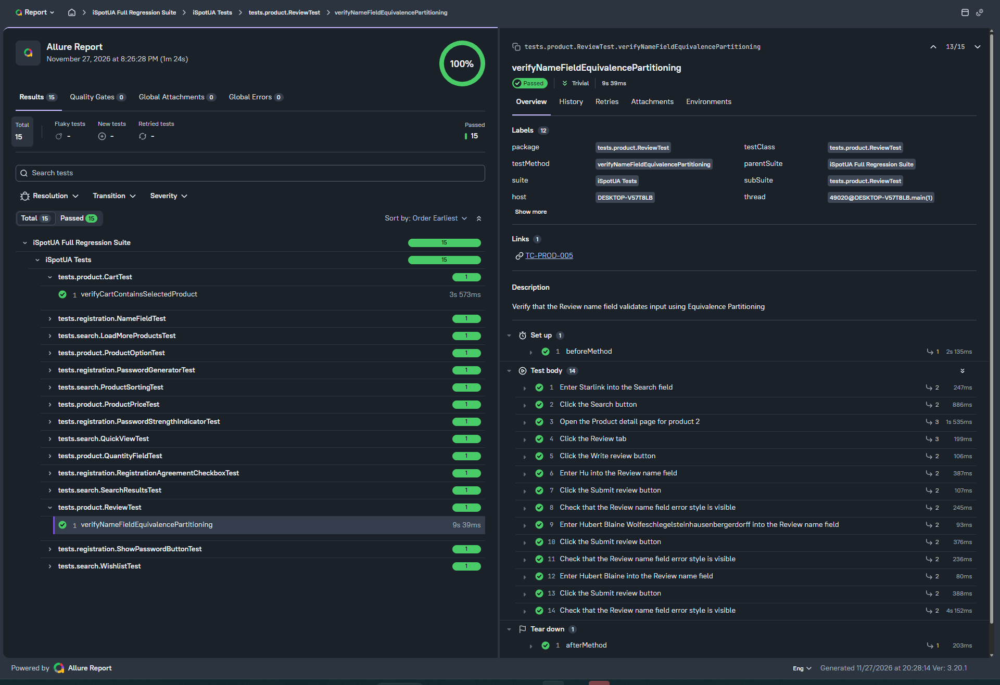

# iSpotUA UI Test Automation Framework

___

Automated functional UI testing framework for the [iSpotUA](https://www.ispot.com.ua/) e-commerce store, built using the
Page Object Model (POM) design pattern.

___

## Tech Stack

- **Language:** Java 17
- **UI Automation:** Selenide
- **Test Framework:** TestNG
- **Report Generation:** Allure Report 3
- **Build Tool:** Maven

___  

## Test Documentation & Coverage

| Module            | Test Cases                                                 | Automated Tests Package                          | Total Tests |
|-------------------|------------------------------------------------------------|--------------------------------------------------|-------------|
| Product Page      | [Product Test Cases](docs/test-cases/product.md)           | [product](src/test/java/tests/product)           | 5           |
| Registration Page | [Registration Test Cases](docs/test-cases/registration.md) | [registration](src/test/java/tests/registration) | 5           |
| Search Page       | [Search Test Cases](docs/test-cases/search.md)             | [search](src/test/java/tests/search)             | 5           |
| **Total**         |                                                            |                                                  | **15**      |

___  

## How to Run Tests & View Report

1. **Run all tests via Maven:**

```bash 
mvn clean test  
```

*(or right click on [runner.xml](runner.xml) in IntelliJ IDEA and select **Run**)*

2. **Generate and open Allure report in browser:**

```bash 
allure serve allure-results
```  

___  

## Test Execution Report (Allure)

> ### [View Live Interactive Allure Report](https://levytskyi.github.io/ispot-automation-framework/allure-report/)

[](https://levytskyi.github.io/ispot-automation-framework/allure-report/)
